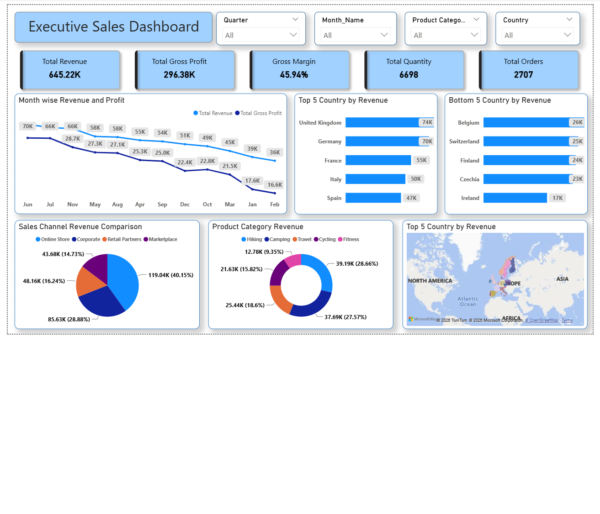

# 📊 Executive Sales Dashboard | Power BI

## Project Overview

An interactive Executive Sales Dashboard developed using Microsoft Power BI to analyze business sales performance and provide meaningful insights through data visualization.

This dashboard helps understand revenue, profitability, sales trends, and country-wise business performance.

## Key Performance Indicators (KPIs)

- **Total Revenue:** 645.22K
- **Total Gross Profit:** 296.38K
- **Gross Margin:** 45.94%
- **Total Quantity:** 6,698
- **Total Orders:** 2,707

## Dashboard Features

- Monthly Revenue and Gross Profit Analysis
- Top 5 Countries by Revenue
- Bottom 5 Countries by Revenue
- Sales Channel Revenue Comparison
- Product Category Revenue Analysis
- Geographic Sales Analysis
- Interactive Slicers for Quarter, Month, Product Category, and Country

## Tools & Technologies

- Microsoft Power BI
- Power Query
- DAX
- Data Visualization

## Skills Demonstrated

- Data Cleaning and Transformation
- Data Analysis
- KPI Development
- Data Visualization
- Interactive Dashboard Design
- Business Performance Analysis

## Dashboard Preview

## Project Files

- **Power BI Dashboard:** [Executive_Sales_Dashboard.pbix](Dashboard/Executive_Sales_Dashboard.pbix)
- **Dashboard Screenshot:** [dashboard_overview.png](Screenshots/dashboard_overview.png)

## Author

**Smita More**

- GitHub: [smitamore-21](https://github.com/smitamore-21)
- Repository: [Executive Sales Dashboard](https://github.com/smitamore-21/Executive-Sales-Dashboard)
